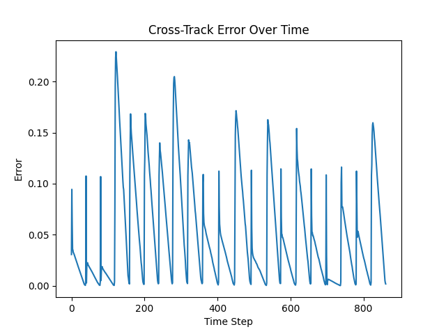
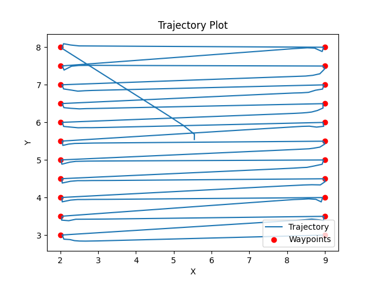
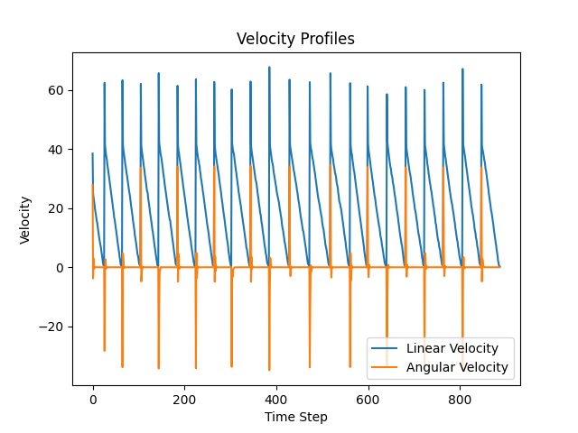
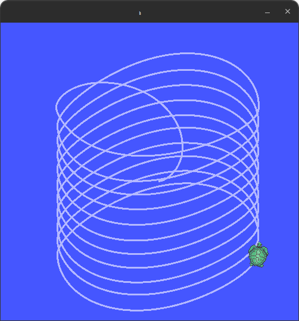
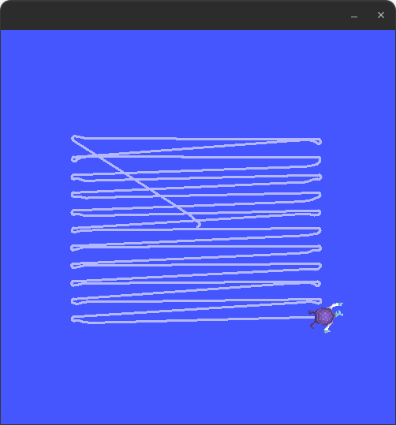

# **First-Order Boustrophedon Navigator** (ROS2)

**Author:** Ayushman M. (https://github.com/aymisxx)  
**Platform:** ROS2 Humble + turtlesim

---

## Background
Boustrophedon patterns (from Greek: "ox-turning", like an ox drawing a plow) are fundamental coverage survey trajectories useful in space exploration and Earth observation. These patterns are useful for:

- **Space Exploration**: Rovers could use boustrophedon patterns to systematically survey areas of interest, ensuring complete coverage when searching for geological samples or mapping terrain. However, due to energy constraints, informative paths are usually optimized, and this results in paths that are sparser than complete coverage sampling, and may still produce high-accuracy reconstructions. 
  
- **Earth Observation**: Aerial vehicles employ these patterns for:
  - Agricultural monitoring and precision farming
  - Search and rescue operations
  - Environmental mapping and monitoring
  - Geological or archaeological surveys
  
- **Ocean Exploration**: Autonomous underwater vehicles (AUVs) use boustrophedon patterns to:
  - Map the ocean floor
  - Search for shipwrecks or aircraft debris
  - Monitor marine ecosystems
  
The efficiency and accuracy of these surveys depend heavily on the robot's ability to follow the prescribed path with minimal deviation (cross-track error). This assignment simulates these real-world challenges in a 2D environment using a first-order dynamical system (the turtlesim robot).

# Overview

This project implements a **first-order PD-controlled boustrophedon (lawnmower) coverage controller** in ROS2 using `turtlesim`.

The objective achieved:

- Achieved complete area coverage.  
- Maintain low cross-track error.  
- Ensuring stable velocity profiles.  
- Provide quantitative performance validation.  
- Implement a custom ROS2 message interface.

All results are reproducible and automatically logged.

# Concept: Boustrophedon Coverage

Boustrophedon motion refers to sweeping parallel lanes while alternating direction at each boundary, similar to mowing a lawn.

### Design Goals
- Uniform lane spacing.  
- Minimal lateral deviation.  
- Stable lane transitions.  
- Full workspace coverage.  

Waypoints are generated for each lane and tracked sequentially using a PD controller.

# Mathematical / System Modeling

## State Variables
- Position: $(x, y)$
- Orientation: $θ$

## Error Definitions

### Distance Error
$$e_d = sqrt((x_t - x)^2 + (y_t - y)^2)$$

### Heading Error
$$e_{θ} = θ_t - θ$$

### Cross-Track Error (CTE)
Signed perpendicular distance from robot position to path segment.

## Control Laws

### Linear Velocity
$$v = Kp_{linear} * e_d + Kd_{linear} * d(e_d)/dt$$

### Angular Velocity
$$omega = Kp_{angular} * e_{θ} + Kd_{angular} * d(e_{θ})/dt$$

Velocity saturation ensures bounded behavior.

# Controller Tuning (Iterative)

Gains were tuned empirically:

1. Start with low Kp.
2. Increase to reduce steady-state error.
3. Introduce Kd to damp oscillations.
4. Evaluate using:
   - Trajectory plot.
   - Velocity profile.
   - Cross-track error metrics.
5. Freeze parameters once grading thresholds were satisfied.

# Final Tuned Parameters

```
Kp_linear   = 6.0
Kd_linear   = 0.3
Kp_angular  = 10.0
Kd_angular  = 0.1
spacing     = 0.5
```

# Quantitative Metrics (Auto-Logged)

```
avg_abs_cross_track_error = 0.051763
max_abs_cross_track_error = 0.229187
samples_used              = 862
```

# Required vs Achieved

| Metric | What We Wanted | Achieved | Status |
|--------|----------|----------|--------|
| Avg (CTE) | < 0.2 | 0.0518 | Achieved. |
| Max (CTE) | < 0.5 | 0.2292 | Achieved. |
| Coverage | Complete | Yes | Achieved. |
| Lane Spacing | Uniform | 0.5 | Achieved. |
| Samples | Sufficient | 862 | Achieved. |

All expectation thresholds satisfied with margin.

# Results

## Cross-Track Error


## Trajectory


## Velocity Profiles


# Coverage Comparison

## Baseline (Default Spiral)


## Tuned Boustrophedon Coverage


# Custom ROS2 Interface

Package:

```
first_order_boustrophedon_interfaces
```

Custom message:

```
PerformanceMetrics.msg
```

Published topic:

```
/performance_metrics
```

Verify:

```
ros2 interface show first_order_boustrophedon_interfaces/msg/PerformanceMetrics
ros2 topic echo /performance_metrics
```

# Dependencies

Ubuntu 22.04  
ROS 2 Humble  

Install:

```
sudo apt install ros-humble-turtlesim
```

# Execution (End-to-End)

## Build

```
cd ~/ros2_ws
colcon build --packages-select first_order_boustrophedon_navigator
source install/setup.bash
```

## Launch

```
ros2 launch first_order_boustrophedon_navigator boustrophedon.launch.py
```

## Monitoring Metrics

```
ros2 topic echo /performance_metrics
```

# Folder Structure

```
first_order_boustrophedon_navigator/
├── README.md                               # this file
├── first_order_boustrophedon_navigator/
│   └── __init__.py
│   └── boustrophedon_controller.py         # main file
│   └── boustrophedon_optimizer.py
│   └── best_params.txt
├── launch/
│   └── boustrophedon.launch.py
├── config/
│   └── boustrophedon_params.yaml
├── scripts/
│   └── boustrophedon_controller
├── resource/
│   └── first_order_boustrophedon_navigator
├── first_order_boustrophedon_interfaces/   # BONUS
│   ├── msg/
│       └── PerformanceMetrics.msg
│   ├── CMakeLists.txt
│   └── package.xml
├── results/
│   ├── metrics.txt
│   ├── cross_track_error.png
│   ├── trajectory.png
│   ├── velocity_profiles.png
│   ├── default_spiral.png
│   └── tuned_boustrophedon.png
└── LICENSE
```

### **Academic Context & Acknowledgment**

This project was completed as part of:

**SES 598: Space Robotics & AI**  
Arizona State University  

**Instructor:** Prof. Jnaneshwar Das  
**GitHub:** https://github.com/darknight-007  

The course is affiliated with the  
**Distributed Robotic Exploration and Mapping Systems (DREAMS) Laboratory**  
**Website:** https://deepgis.org/dreamslab  
**GitHub:** https://github.com/DREAMS-lab

The assignment structure, evaluation methodology, and coverage-control framework were inspired by course material and lab research themes in autonomous systems and robotic exploration.

# Key Takeaways

- Empirical PD tuning effectively stabilizes first-order systems.
- Cross-track error provides objective performance validation.
- Quantitative metrics strengthen controller evaluation.
- ROS 2 interfaces enable modular telemetry expansion.

---